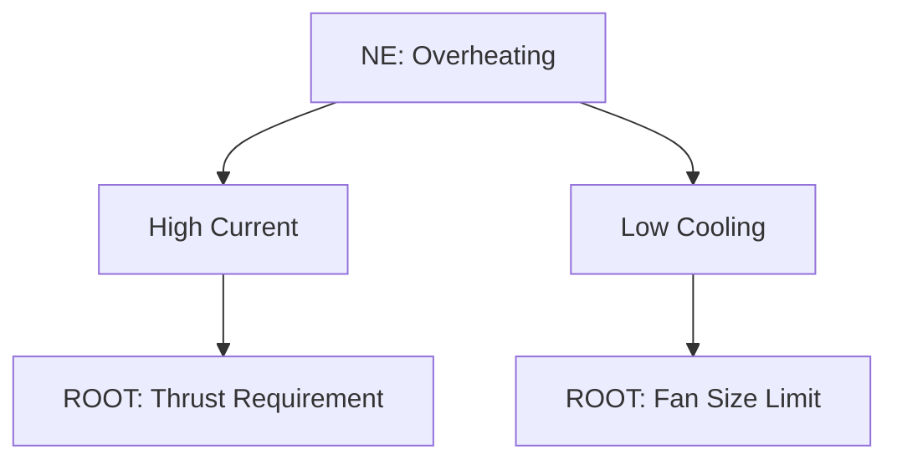

# Example: Engine Overheating (Technical System)

## Input
"The electric motor in our drone overheats after 10 minutes of flight."

## Execution Trace
1.  **Problem Definition:**
    - NE: Motor Overheating ($T > 100^\circ C$).
    - Observed: Happens only during hovering, not forward flight.

2.  **Chain of Causes (CECA):**
    - **Why Overheat?**
      - Cause 1: High Current (I^2*R loss).
      - AND
      - Cause 2: Poor Cooling (Airflow low).

    - **Digging Cause 1 (High Current):**
      - Why High Current? -> To generate Thrust to hold weight.
      - Why Hold Weight? -> Drone is heavy.
      - **Root 1 (Contradiction):** We need High Current (for Thrust/Lift) BUT High Current causes Heat.

    - **Digging Cause 2 (Poor Cooling):**
      - Why Poor Cooling? -> Fan is small + No incoming wind (hovering).
      - Why Fan small? -> **Because fan consumes power (Weight/Energy trade-off).**
      - **Root 2 (Contradiction):** Fan must be BIG (for cooling) AND SMALL (to save energy/weight).

    - **Human Factor Check:** "Pilot flies too aggressively?" -> No, system allows it. Rephrase: "Cooling system inadequate for max load."

3.  **RCA+ (The "Plus"):**
    - Root 2 is a clear Technical Contradiction.
    - "Fan must be Big and Small."

## Output
## 🌳 RCA+ Analysis: Drone Motor Overheating

### 1. Causality Logic

### 2. Root Cause & Contradiction Extraction
**Root Cause: Fan Geometry**
- **Chain:** Overheat -> Low Airflow -> Small Fan.
- **The "Plus" (+):** Why is the fan small? -> Because a larger fan adds weight and drag.
- **Draft Contradiction:** "The Fan must be Large (for cooling) but Small (for aerodynamics/weight)."

### 3. Next Step Guidance
| Cause Type | Action | Handoff |
|------------|--------|---------|
| Design Choice (Fan Size) | Solve Technical Contradiction | **→ @contradictions** |

## ➡️ Next Step
Transmitting to **@contradictions**:
- **Conflict:** Fan Size vs Cooling Efficiency.
